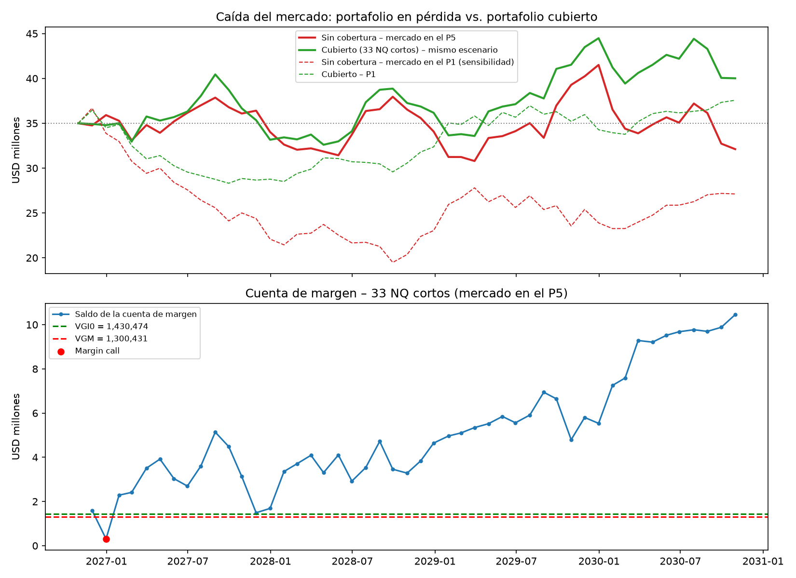
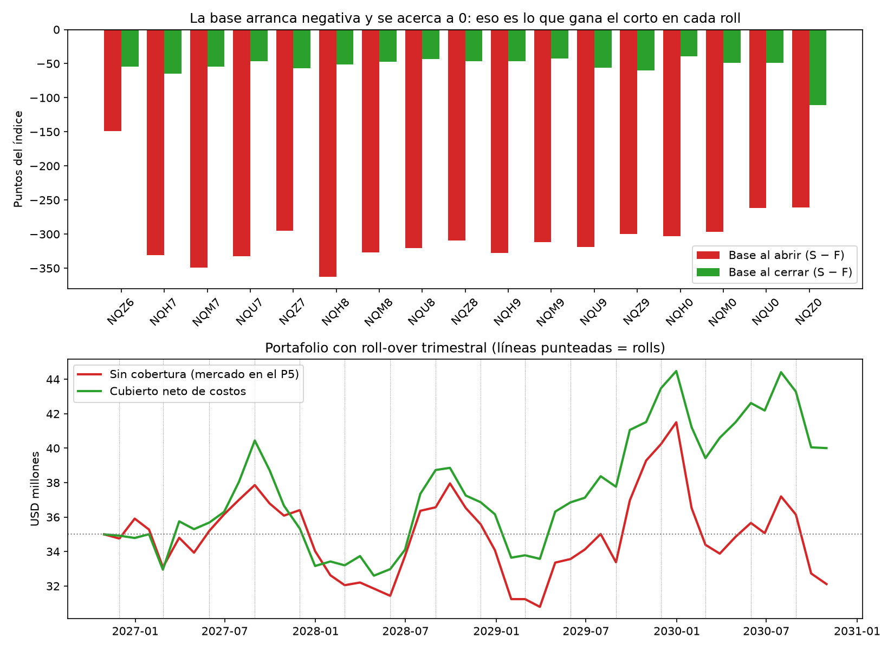
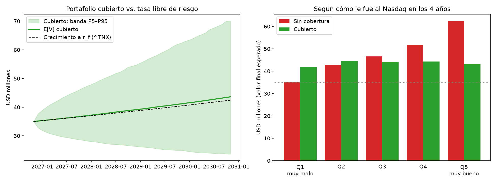
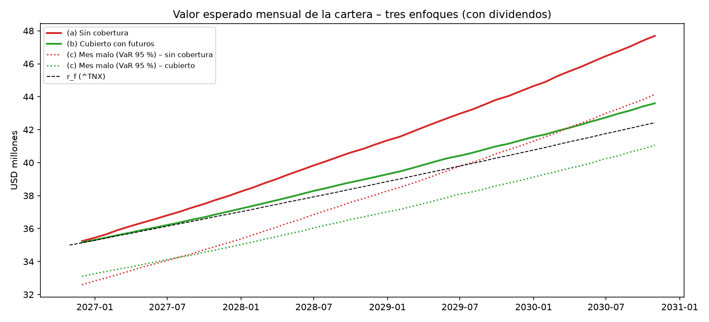
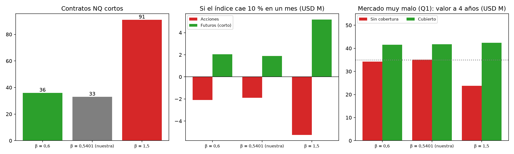

# Informe inversión Nasdaq-100

**Lab #2 – Derivados Financieros** · 2026 · Por: Juan Quintero, Jovan Saldarriaga, John Zapata

## 1. Selección del portafolio

### 1.1. Identificación del índice bursátil:

Seleccionamos estas tres acciones, Cisco Systems (CSCO), Analog Devices (ADI) y Amgen (AMGN), por su pertenencia al índice Nasdaq-100, su posicionamiento competitivo y sus fundamentos financieros. Consideramos que sus actividades en infraestructura tecnológica, semiconductores y biotecnología ofrecen oportunidades de crecimiento y diversificación sectorial. Asimismo, evaluamos su capacidad de generación de ingresos, estabilidad financiera, evolución bursátil y expectativas de valorización. Finalmente, analizaremos su comportamiento histórico para determinar su contribución al portafolio óptimo de mínima varianza.

|                     | CSCO – Cisco Systems                                                                                                       | ADI – Analog Devices                                                                                                         | AMGN – Amgen                                                                                                                      |
|---------------------|----------------------------------------------------------------------------------------------------------------------------|------------------------------------------------------------------------------------------------------------------------------|-----------------------------------------------------------------------------------------------------------------------------------|
| Objeto Social       | Equipos de redes y ciberseguridad para empresas y centros de datos.                                                        | Chips que convierten señales del mundo físico (temperatura, sonido, energía, movimiento) en datos.                           | Biotecnológica: desarrolla y vende medicamentos biológicos para enfermedades serias.                                              |
| Sector              | Tecnología · equipos de comunicación                                                                                       | Tecnología · semiconductores                                                                                                 | Salud · biotecnología                                                                                                             |
| Cómo se financia    | Más de la mitad son equipos de red; el resto es seguridad, colaboración y contratos de soporte, que dan ingresos estables. | Casi la mitad va a la industria (fábricas, defensa, medición); el resto a carros, centros de datos y electrónica de consumo. | Venta de medicamentos: colesterol (Repatha), huesos (Prolia, Evenity), inflamación (Enbrel, Otezla), cáncer y enfermedades raras. |
| Precio              | +46.0 % en el año, pero 19.6 % debajo de su máximo: viene corrigiendo desde junio.                                         | +81.3 % en el año, cerca de su máximo (−6.4 %).                                                                              | +64.0 % en el año y cerró en su máximo; la caída más suave de las tres (−16.6 %).                                                 |
| Finanzas            | Ingresos USD 63,325 M, margen operativo 27.6 %, FCF USD 12,767 M. Deuda baja (0.68x EBITDA).                               | Margen operativo 36.4 % y FCF del 35.6 % de las ventas. Deuda baja (0.97x).                                                  | Ingresos USD 38,095 M, margen operativo 34.0 %, FCF USD 10,175 M. Deuda alta pero pagable (2.46x; intereses cubiertos 4.9x).      |
| Expectativa a 1 año | USD 124.49 (+19.1 %)                                                                                                       | USD 611.25 (+46.5 %)                                                                                                         | USD 520.66 (+11.7 %)                                                                                                              |
| Riesgos operativos  | Que se frene el gasto en IA y redes.                                                                                       | Es cíclica y está cara (P/E 37x).                                                                                            | Biosimilares que compiten con Prolia, recortes de precios de Medicare en EE. UU. y la deuda.                                      |
| Por qué lo elegimos | Estabilidad y renta (dividendo 1.6 %).                                                                                     | Crecimiento.                                                                                                                 | Defensa: es de salud, se mueve poco con la tecnología y paga el mayor dividendo (2.1 %).                                          |

*Tabla #1 Empresas*

### 1.2. Situación financiera:

El análisis financiero evidencia que CSCO y ADI mantienen niveles de endeudamiento conservadores, con relaciones deuda neta/EBITDA de 0.68x y 0.97x, respectivamente, así como sólidas coberturas de intereses superiores a 11 veces, lo que refleja una alta capacidad para atender sus obligaciones financieras. En contraste, AMGN presenta un mayor nivel de apalancamiento, con una deuda neta de USD 43,315 millones y una relación deuda neta/EBITDA de 2.46x. No obstante, la compañía conserva una posición financiera sólida gracias a su elevada generación de flujo de caja libre (USD 10,175 millones), márgenes operativos del 34.0 % y adecuada liquidez de corto plazo (razón corriente de 1.37x).

|                        | CSCO   | ADI    | AMGN   |
|------------------------|--------|--------|--------|
| Ingresos 12m (USD M)   | 63,325 | 13,882 | 38,095 |
| Margen operativo       | 27.6%  | 36.4%  | 34.0%  |
| Margen neto            | 21.0%  | 29.8%  | 23.0%  |
| ROE                    | 26.4%  | 12.3%  | 74.8%  |
| Caja (USD M)           | 15,918 | 2,325  | 13,989 |
| Deuda total (USD M)    | 29,533 | 9,122  | 57,304 |
| Deuda neta (USD M)     | 13,615 | 6,797  | 43,315 |
| EBITDA 12m (USD M)     | 20,019 | 7,026  | 17,622 |
| Deuda neta / EBITDA    | 0.68x  | 0.97x  | 2.46x  |
| Cobertura de intereses | 11.89x | 14.41x | 4.86x  |
| FCF 12m (USD M)        | 12,767 | 4,937  | 10,175 |
| FCF / ingresos         | 20.2%  | 35.6%  | 26.7%  |
| FCF / deuda neta       | 93.8%  | 72.6%  | 23.5%  |
| FCF / dividendos       | 1.95x  | 2.42x  | 1.93x  |
| Razón corriente        | 0.93x  | 1.25x  | 1.37x  |

*Tabla #2 Resumen financiero*

### 1.3. Expectativa de precio a un año:

La valoración fundamental evidencia un potencial de apreciación positivo para los tres activos analizados. ADI presenta la mayor expectativa de valorización, con un precio objetivo de USD 611.25 y un retorno esperado de 46.5%, respaldado por un crecimiento significativo del beneficio por acción esperado. CSCO muestra un potencial intermedio, con un retorno esperado de 19.1% y un precio objetivo de USD 124.49. Por su parte, AMGN registra la menor valorización esperada (11.7%), sugiriendo un perfil más orientado a la estabilidad que al crecimiento.

|      | Precio 30/10/2026 | EPS 12m | P/E   | EPS esperado | Precio objetivo | Escenario bajo | Escenario alto | Retorno esperado |
|------|-------------------|---------|-------|--------------|-----------------|----------------|----------------|------------------|
| CSCO | 104.51            | 4.32    | 24.19 | 5.15         | 124.49          | 122.17         | 135.72         | 19.1%            |
| ADI  | 417.11            | 11.26   | 37.04 | 16.50        | 611.25          | 531.33         | 666.78         | 46.5%            |
| AMGN | 466.01            | 22.37   | 20.83 | 24.99        | 520.66          | 489.97         | 553.30         | 11.7%            |

*Tabla #3 Precio esperado*

## 2. Retornos, volatilidad anualizada y matrices de riesgo

### 2.1. Retornos y volatilidad

Los resultados evidencian perfiles de riesgo y rentabilidad diferenciados entre los activos analizados. ADI registra la mayor rentabilidad anual (22.84%), aunque también la mayor volatilidad (27.99%), reflejando una mayor exposición al riesgo. Por el contrario, AMGN presenta una rentabilidad similar a la de CSCO (16.10 % y 16.40 %, respectivamente) con la menor volatilidad de la muestra (23.28 %), característica favorable para estrategias orientadas a la minimización del riesgo. Asimismo, los tres activos exhiben una proporción de meses positivos superior al 55 %, evidenciando consistencia en la generación de retornos. En términos de distribución, los coeficientes de asimetría y curtosis se mantienen cercanos a los valores de una distribución normal, con excepción de CSCO, que presenta una mayor curtosis debido a la presencia de movimientos extremos.

|       | Media mensual | Desv. mensual | Retorno anual | Volatilidad anual | Meses en verde | Asimetría | Curtosis exceso |
|-------|---------------|---------------|---------------|-------------------|----------------|-----------|-----------------|
| CSCO  | 1.27%         | 6.97%         | 16.40%        | 24.14%            | 58.33%         | 0.33      | 1.24            |
| ADI   | 1.71%         | 8.08%         | 22.84%        | 27.99%            | 55.00%         | 0.11      | 0.01            |
| AMGN  | 1.24%         | 6.72%         | 16.10%        | 23.28%            | 56.67%         | 0.08      | -0.36           |
| ^NDX  | 1.48%         | 5.49%         | 19.45%        | 19.02%            | 65.83%         | -0.36     | 0.13            |

*Tabla #4 Estadísticas de mercado y desempeño histórico de ADI, AMGN, CSCO y el Nasdaq-100*

### 2.2. Matriz de varianza y covarianza

Las varianzas, ubicadas en la diagonal principal, muestran que ADI presenta la mayor variabilidad de los rendimientos (0.00653), seguida por CSCO (0.00485) y AMGN (0.00452), lo que confirma que ADI es el activo con mayor riesgo individual dentro del portafolio analizado.

Las covarianzas entre los activos son positivas, lo que indica que las acciones tienden a moverse en la misma dirección. Sin embargo, estas relaciones son moderadas. La mayor covarianza se observa entre CSCO y ADI (0.00206), sugiriendo una mayor sincronización en sus movimientos. Por su parte, AMGN presenta las menores covarianzas con CSCO (0.00105) y ADI (0.00142), lo que indica un comportamiento relativamente más independiente frente a los otros activos.

|      | CSCO    | ADI     | AMGN    |
|------|---------|---------|---------|
| CSCO | 0.00485 | 0.00206 | 0.00105 |
| ADI  |         | 0.00653 | 0.00142 |
| AMGN |         |         | 0.00452 |

*Tabla #5 Matriz de varianzas*

### 2.3. Matriz de correlaciones

La matriz de correlaciones muestra que los tres activos presentan correlaciones positivas moderadas, lo que indica que tienden a moverse en la misma dirección, aunque no de manera perfecta. La mayor correlación se observa entre ADI y el Nasdaq-100 (^NDX) (0.60), seguida por CSCO y el Nasdaq-100 (0.57), lo que sugiere una mayor sensibilidad de estas compañías a los movimientos del mercado tecnológico. Por su parte, AMGN presenta la menor correlación con el índice (0.20), evidenciando un comportamiento más independiente respecto al mercado.

Entre las acciones individuales, la correlación más alta corresponde a CSCO y ADI (0.37), mientras que las relaciones entre ADI y AMGN (0.26) y CSCO y AMGN (0.22) son relativamente bajas. Estos resultados indican que AMGN aporta el mayor beneficio de diversificación dentro del conjunto de activos, al presentar una menor dependencia de los movimientos de las demás acciones y del índice de referencia.

|      | CSCO | ADI  | AMGN | ^NDX |
|------|------|------|------|------|
| CSCO | 1    | 0.37 | 0.22 | 0.57 |
| ADI  |      | 1    | 0.26 | 0.60 |
| AMGN |      |      | 1    | 0.20 |
| ^NDX |      |      |      | 1    |

*Tabla #6 Matriz de Correlaciones*

El análisis de las matrices de varianzas, covarianzas y correlaciones evidencia que los activos presentan niveles de riesgo diferenciados y una relación positiva, aunque moderada, entre sus rendimientos, ADI registra la mayor varianza, confirmando su condición de activo con mayor volatilidad individual, mientras que AMGN presenta una menor relación tanto con CSCO como con ADI, reflejada en las covarianzas y correlaciones más bajas del conjunto. Asimismo, las correlaciones observadas se mantienen alejadas de la unidad, lo que indica que los activos no se mueven de manera perfectamente sincronizada.

## 3. Portafolio óptimo

### 3.1. Portafolio de mínima varianza

Luego del análisis del riesgo individual y la relación entre los rendimientos de los activos mediante las matrices de varianzas, covarianzas y correlaciones, construimos el portafolio óptimo de mínima varianza, este modelo busca determinar la combinación de pesos que minimiza el riesgo total del portafolio, considerando simultáneamente la volatilidad de cada activo y su grado de dependencia con los demás.

| Acción | Peso Óptimo | Capital Asignado |
|--------|-------------|------------------|
| CSCO   | 36.71%      | 12,849,220.18    |
| ADI    | 19.37%      | 6,778,005.51     |
| AMGN   | 43.92%      | 15,372,774.31    |
| TOTAL  | 100.00%     | 35,000,000.00    |

*Tabla #7 Portafolio óptimo de mínima varianza*

El modelo asignó la mayor proporción del capital a AMGN (43.92%), equivalente a \$15,372,774.31, seguida de CSCO (36.71%) con \$12,849,220.18 y ADI (19.37%) con \$6,778,005.51. Esta distribución refleja el objetivo de minimizar el riesgo total del portafolio, favoreciendo los activos con menor volatilidad y mayores beneficios de diversificación. Aunque ADI presenta el mayor potencial de rentabilidad, su mayor nivel de riesgo limita su participación dentro de la solución óptima

### 3.2. Análisis de Sharpe

Desde la perspectiva del retorno ajustado por riesgo, el portafolio resulta atractivo, ya que genera una prima de riesgo positiva y un Ratio de Sharpe de 0.64, lo que confirma que la estrategia de diversificación implementada permite obtener una rentabilidad esperada competitiva sin asumir niveles excesivos de volatilidad. Para la compañía inversionista, esto sugiere una alternativa eficiente de asignación de capital bajo los criterios del modelo de Markowitz.

|                                                      | Mensual | Anualizado |
|------------------------------------------------------|---------|------------|
| 1\. Retorno esperado del portafolio (μ_p)            | 1.3520% | 17.49%     |
| 2\. Tasa libre de riesgo (r_f - Bono ^TNX)           | 0.4018% | 4.93%      |
| 3\. Exceso de retorno / Prima por riesgo (μ_p - r_f) | 0.9503% | 12.56%     |
| 4\. Volatilidad del portafolio (σ_p)                 | 5.1423% | 17.81%     |
| INDICADOR DE SHARPE \[(μ_p - r_f) / σ_p\]            | 0.1848  | 0.6402     |

*Tabla #8 Ratio de Sharpe*

## 4. Calidad de datos, fuentes y trazabilidad del modelo de portafolio

Para que los resultados se puedan reproducir y revisar, documentamos de dónde salió cada dato y cómo lo tratamos antes de usarlo en el modelo. Los precios de CSCO, ADI y AMGN, del índice Nasdaq-100 (^NDX) y de la tasa ^TNX los descargamos de Yahoo Finance con la librería yfinance de Python. Los guardamos como archivos CSV en la carpeta data/ del repositorio. CSCO, ADI, ^NDX y ^TNX se descargaron el 01/11/2026. AMGN se descargó aparte el 10/11/2026, cuando reemplazó a PYPL por indicación del docente.

| Dato                                       | Fuente              |
|--------------------------------------------|---------------------|
| Precios de CSCO, ADI, AMGN y el Nasdaq-100 | Yahoo Finance       |
| Tasa libre de riesgo ^TNX                  | Yahoo Finance       |
| Estados financieros y EPS esperado         | Yahoo Finance       |
| Acciones que componen el Nasdaq-100        | Investing.com       |
| Especificaciones y márgenes del futuro     | CME Group           |
| Prima de riesgo del mercado                | Damodaran           |
| Comisiones de negociación                  | Interactive Brokers |

*Tabla #9 Fuentes de información*

Trabajamos con una ventana de 10 años, del 31/10/2016 al 30/10/2026, dentro del rango de 6 a 10 años que pide el laboratorio. Usamos frecuencia mensual en todo el modelo: estadística, Markowitz, VaR, betas y simulación. Tomamos el precio del último día de bolsa de cada mes, lo que da 120 retornos logarítmicos entre noviembre de 2016 y octubre de 2026. Elegimos la frecuencia mensual porque el VaR, la simulación y la liquidación de la cuenta de margen también son mensuales, y así no mezclamos unidades. Los valores anuales que mostramos se anualizan solo para facilitar la lectura: el retorno mensual se capitaliza por 12 meses y la volatilidad mensual se multiplica por la raíz de 12. En los cálculos se usan los valores mensuales.

Usamos el precio ajustado (Adj Close), que ya incluye los dividendos reinvertidos, de modo que los retornos son de retorno total. Para no contar los dividendos dos veces, en el análisis de rendimiento con dividendos no los sumamos al retorno, sino que lo separamos en dos partes: lo que aporta el precio y lo que aportan los dividendos.

En la limpieza unimos las series por fecha y revisamos que no hubiera huecos ni desfases entre las acciones y el índice. En los 2,514 días de la ventana no encontramos valores faltantes, fechas duplicadas ni precios en cero o negativos. El mayor salto entre fechas fue de 4 días y corresponde a fines de semana con festivo.

Por último, cuidamos la coherencia temporal: todos los insumos tienen corte al 30/10/2026, fecha de inicio de la inversión. Eso incluye precios, ^TNX, estados financieros, EPS y especificaciones del futuro.

## 5. VaR mensual del portafolio al 1% y 5% como base de cobertura

Para complementar la evaluación del riesgo del portafolio, se estimó el Valor en Riesgo (VaR), indicador que cuantifica la pérdida máxima esperada para un nivel de confianza y horizonte temporal determinados. Esta medida permite evaluar la exposición del portafolio a posibles pérdidas y proporciona una referencia adicional para la gestión y control del riesgo de inversión.

|         | z      | Retorno crítico (log) | VaR (%) | VaR (USD)    | VaR histórico (%) | VaR histórico (USD) | Meses que lo pasaron | Esperados | p-valor (binomial) |
|---------|--------|-----------------------|---------|--------------|-------------------|---------------------|----------------------|-----------|--------------------|
| VaR 95% | 1.6449 | -7.12%                | 6.87%   | 2,403,871.07 | 7.16%             | 2,504,910.11        | 10                   | 6.0       | 0.079              |
| VaR 99% | 2.3263 | -10.62%               | 10.08%  | 3,526,392.10 | 8.50%             | 2,975,753.42        | 0                    | 1.2       | 1000               |

*Tabla #10 VaR*

La correlación del portafolio de mínima varianza con el Nasdaq-100 es de 0.58 (R² = 0.3327), lo que implica que aproximadamente el 33% del riesgo total es sistemático y, por tanto, susceptible de cobertura mediante futuros sobre el índice. El 67% restante corresponde a riesgo específico de CSCO, ADI y AMGN, que no puede eliminarse mediante este tipo de instrumentos. Bajo una cobertura perfecta del componente sistemático, el VaR al 95% se reduciría de USD 2,403,871 a USD 1,895,079, mientras que el VaR al 99% disminuiría de USD 3,526,392 a USD 2,829,339, representando reducciones cercanas al 20%. Estos resultados evidencian que la diversificación ya ha mitigado una parte importante del riesgo del portafolio, limitando el beneficio adicional de la cobertura.

## 6. Estimación de betas CAPM individuales y beta del portafolio

Evaluamos si la rentabilidad esperada de los activos es consistente con el riesgo sistemático asumido, medido a través de su beta (β). Adicionalmente, indicadores como el alfa (α) y el R² permiten analizar si el activo genera rendimientos superiores a los explicados por el mercado y qué proporción de su comportamiento está asociada a los movimientos de este.

|               | Peso MV | β      | Error est. β | t de β | R²     | α mensual | E(r) CAPM mensual | E(r) histórico mensual | E(r) CAPM anual (ref.) | E(r) histórico anual (ref.) |
|---------------|---------|--------|--------------|--------|--------|-----------|-------------------|------------------------|------------------------|-----------------------------|
| CSCO          | 36.71%  | 0.7173 | 0.0964       | 7.44   | 31.95% | 0.20%     | 1.18%             | 1.27%                  | 15.17%                 | 16.40%                      |
| ADI           | 19.37%  | 0.8774 | 0.1087       | 8.07   | 35.56% | 0.42%     | 1.36%             | 1.73%                  | 17.57%                 | 22.84%                      |
| AMGN          | 43.92%  | 0.2434 | 0.1104       | 2.21   | 3.96%  | 0.88%     | 0.67%             | 1.25%                  | 8.31%                  | 16.10%                      |
| Portafolio MV | 100.00% | 0.5401 | –            | –      | –      | –         | 0.99%             | 1.35%                  | 12.56%                 | 17.49%                      |

*Tabla #11 Beta*

Los resultados indican que ADI (β = 0.8774) es el activo con mayor sensibilidad a los movimientos del mercado, seguido de CSCO (β = 0.7173), mientras que AMGN (β = 0.2434) presenta la menor exposición al riesgo sistemático. Además, los tres activos registran alfas positivas, lo que sugiere un desempeño superior al esperado según el CAPM. A nivel de portafolio, la beta de 0.5401 refleja una sensibilidad moderada al mercado. Asimismo, la rentabilidad histórica esperada (17.49%) supera la rentabilidad estimada por el CAPM (12.56%), evidenciando una compensación favorable entre riesgo y retorno.

## 7. Selección técnica del futuro sobre índice y parámetros contractuales

Para implementar la estrategia de cobertura se seleccionó un contrato de futuros sobre el Nasdaq-100, dado que este índice presenta una relación directa con el componente sistemático del riesgo identificado en el portafolio. La Tabla 12 resume las principales especificaciones técnicas del contrato utilizado, incluyendo sus características de negociación, vencimiento, requisitos de margen y plataforma bursátil.

| Especificación                  | Valor                                   |
|---------------------------------|-----------------------------------------|
| Contrato                        | NQZ6                                    |
| Subyacente                      | Nasdaq-100 (^NDX)                       |
| Tamaño (Q_F)                    | USD 20 × índice                         |
| Tick mínimo                     | 0.25 puntos                             |
| Valor del tick                  | USD 5.00 por contrato                   |
| Precio inicial F0 (30/10/2026)  | 28,534.00                               |
| Vencimientos                    | mar, jun, sep, dic (tercer viernes)     |
| Vencimiento NQZ6                | 18/12/2026                              |
| Liquidación al vencimiento      | en efectivo                             |
| Mark-to-market                  | diario en CME; mensual en el lab        |
| Margen de mantenimiento (corto) | USD 39,407 por contrato                 |
| Margen inicial (supuesto)       | USD 43,347.70 por contrato (1.10 × VGM) |
| Plataforma                      | CME Globex (CME Group)                  |

*Tabla #12 Contrato*

## 8. Número óptimo de contratos de futuros sobre índice

Aplicando la fórmula de cobertura de riesgo sistemático se requiere teóricamente 33.13 contratos, pero el mercado bursátil no admite fracciones (indivisibilidad contractual) y obliga a elegir entre 33 o 34 unidades. Tomar 33 contratos cortos protege el 99.62% del riesgo de mercado y deja sin cubrir apenas USD 72,719.95, un descalce mínimo de 0.38% que casi no afecta al portafolio de 35 millones de dólares. Por el contrario, subir a 34 contratos cubre un 102.63% y genera un exceso de USD 497,960.05, descalce casi siete veces mayor que crearía una posición bajista neta perjudicial si el mercado sube. Por ello, 33 contratos es la decisión técnica óptima: minimiza el desvío numérico y preserva el objetivo genuino de protección sin especulación.

|              | Contratos | Exposición cubierta (USD) | Razón de cobertura | Exposición que queda (USD) |
|--------------|-----------|---------------------------|--------------------|----------------------------|
| Hacia abajo  | 33        | 18,832,440                | 99.62%             | 72,719.95                  |
| Hacia arriba | 34        | 19,403,120                | 102.63%            | -497,960.05                |

*Tabla #13 número óptimo de contratos*

## 9. Definición de posición corta o larga según objetivo de cobertura

Para validar la efectividad de la estrategia y corroborar el impacto de la posición corta frente a una posición larga en futuros, se estructuró un análisis de estrés ante variaciones en el índice Nasdaq-100 en un rango de ±20%, detallando el comportamiento del contrato NQZ6, el resultado económico del portafolio accionario y el efecto neto consolidado bajo ambas alternativas. La cobertura mediante futuros cortos protege el valor de la cartera frente a caídas generalizadas sin incurrir en costos de liquidación ni fricciones fiscales. Al vender 33 contratos, las pérdidas en las acciones se compensan de manera simétrica con las ganancias por liquidación diaria en futuros, mientras que una posición larga duplicaría el deterioro patrimonial al operar como apalancamiento especulativo.

|     | Δ índice | F final   | ΔF (pts)  | Ticks   | P&G largo  | P&G corto  | Δ acciones | Neto acciones + corto | Neto acciones + largo |
|-----|----------|-----------|-----------|---------|------------|------------|------------|-----------------------|-----------------------|
| 0   | -20%     | 22,827.25 | -5,706.75 | -22,827 | -3,766,455 | 3,766,455  | -3,781,032 | -14,577               | -7,547,487            |
| 1   | -10%     | 25,680.5  | -2,853.5  | -11,414 | -1,883,310 | 1,883,310  | -1,890,516 | -7,206                | -3,773,826            |
| 2   | -5%      | 27,107.25 | -1,426.75 | -5,707  | -941,655   | 941,655    | -945,258   | -3,603                | -1,886,913            |
| 3   | 5%       | 29,960.75 | 1,426.75  | 5,707   | 941,655    | -941,655   | 945,258    | 3,603                 | 1,886,913             |
| 4   | 10%      | 31,387.5  | 2,853.5   | 11,414  | 1,883,310  | -1,883,310 | 1,890,516  | 7,206                 | 3,773,826             |

*Tabla #14 definición de posición*

## 10. Flujos mensuales, mark-to-market y margin call usando ticks

Con los 33 contratos cortos definidos, seguimos la cuenta de margen mes a mes durante los 48 meses de la inversión. Como el horizonte es futuro, el precio del futuro sale de la simulación mensual del índice. Tomamos como escenario el peor caso del mercado: la trayectoria en la que el Nasdaq-100 cae 27.2% en 4 años. El número de ticks del mes es la variación del futuro dividida entre 0.25. Cada tick vale USD 5 por contrato, y el resultado del mes es el número de ticks por USD 5 por los 33 contratos.

La cuenta arranca con el margen inicial: USD 43,347.70 por contrato, es decir, USD 1,430,474.10 por los 33 contratos. El margen de mantenimiento es de USD 39,407 por contrato, USD 1,300,431 en total. Asumimos liquidación mensual, aunque en CME el mark-to-market es diario. Cada mes el resultado de los futuros se suma o se resta del saldo. Si el saldo queda por debajo del margen de mantenimiento, hay un llamado al margen y se debe reponer la diferencia hasta volver al margen inicial. Las ganancias se dejan en la cuenta, sin retiros.

En este escenario hubo un solo llamado al margen, en diciembre de 2026: el índice subió 7.2%, la posición corta perdió USD 1,289,640 y hubo que reponer USD 1,122,660 para volver al margen inicial. Después el mercado bajó, la posición corta ganó en 32 de los 48 meses y la cuenta terminó con USD 10,454,489.10.

| Trimestre | Contrato | Ticks   | P&G largo  | P&G corto  | Llamados al margen | Reposición | Saldo de margen |
|-----------|----------|---------|------------|------------|--------------------|------------|-----------------|
| T1        | NQH7     | 1,619   | 267,135    | -267,135   | 1                  | 1,122,660  | 2,285,999       |
| T2        | NQM7     | -9,891  | -1,632,015 | 1,632,015  | 0                  | 0          | 3,918,014       |
| T3        | NQU7     | 1,907   | 314,655    | -314,655   | 0                  | 0          | 3,603,359       |
| T4        | NQZ7     | 2,864   | 472,560    | -472,560   | 0                  | 0          | 3,130,799       |
| T5        | NQH8     | -1,368  | -225,720   | 225,720    | 0                  | 0          | 3,356,519       |
| T6        | NQM8     | 313     | 51,645     | -51,645    | 0                  | 0          | 3,304,874       |
| T7        | NQU8     | -1,418  | -233,970   | 233,970    | 0                  | 0          | 3,538,844       |
| T8        | NQZ8     | 1,549   | 255,585    | -255,585   | 0                  | 0          | 3,283,259       |
| T9        | NQH9     | -10,182 | -1,680,030 | 1,680,030  | 0                  | 0          | 4,963,289       |
| T10       | NQM9     | -3,369  | -555,885   | 555,885    | 0                  | 0          | 5,519,174       |
| T11       | NQU9     | -2,375  | -391,875   | 391,875    | 0                  | 0          | 5,911,049       |
| T12       | NQZ9     | 6,761   | 1,115,565  | -1,115,565 | 0                  | 0          | 4,795,484       |
| T13       | NQH0     | -14,893 | -2,457,345 | 2,457,345  | 0                  | 0          | 7,252,829       |
| T14       | NQM0     | -11,860 | -1,956,900 | 1,956,900  | 0                  | 0          | 9,209,729       |
| T15       | NQU0     | -3,404  | -561,660   | 561,660    | 0                  | 0          | 9,771,389       |
| T16       | NQZ0     | -4,140  | -683,100   | 683,100    | 0                  | 0          | 10,454,489      |

*Tabla #15 Flujos trimestrales de la cuenta de margen en USD*

Para ver qué tan frecuente es este problema, repetimos el cálculo en las 10,000 trayectorias simuladas. En promedio hay 7.6 llamados al margen en los 48 meses y la reposición total es de USD 9.08 M. En el percentil 95 se llega a 18 llamados y USD 26.16 M repuestos, con un solo mes que exige hasta USD 4.63 M. Esto muestra que el costo real de la cobertura corta es de liquidez. Cuando el mercado sube, las acciones ganan, pero la cuenta de margen exige flujo de efectivo para la operación. Por eso hay que tener caja disponible.

## 11. Estrategia de roll-over trimestral y rentabilidad de la cobertura

El portafolio cubierto neto integra acciones, P&G acumulado de futuros y costos de transacción a lo largo de 48 meses y 16 ciclos de roll-over. En el escenario de estrés (percentil 5), la cobertura revierte un resultado adverso en el cual transforma una caída de -8.25% (USD 32.11 M) sin cobertura en una ganancia de +14.30% (USD 40.00 M), reduciendo la volatilidad mensual al 4.24% y conteniendo el peor mes del -11.99% al -7.47%. En las 10,000 trayectorias, las comisiones y fricciones operativas totales son marginales (USD 8,131, apenas -0.01% anual). La pérdida esperada en futuros spot (-USD 7.54 M) se compensa notablemente por un roll yield favorable promedio de +USD 3.46 M (+2.38% anual) derivado del contango (la base arranca negativa y converge a cero). El análisis de sensibilidad muestra que ante variaciones de ±1% en el costo de transporte, el valor esperado cubierto neto oscila entre USD 42.71 M y USD 44.49 M, ratificando la robustez y solidez defensiva de la estrategia.

|                             | Sin cobertura | Cubierto neto (corto + roll + costos) |
|-----------------------------|---------------|---------------------------------------|
| Valor final (USD)           | 32,113,166    | 40,006,390                            |
| Rentabilidad total          | -8.25%        | 14.30%                                |
| Rentabilidad anual efectiva | -2.13%        | 3.40%                                 |
| Volatilidad mensual         | 4.71%         | 4.24%                                 |
| Peor mes                    | -11.99%       | -7.47%                                |

*Tabla #16 Roll Over*

## 12. Valor esperado de la cobertura trimestral y tasa libre de riesgo

Como tasa libre de riesgo usamos el rendimiento del bono del Tesoro de EE. UU. a 10 años (^TNX), observado al 30/10/2026 en 4.929% anual (Yahoo Finance). Aunque el enunciado describe ^TNX como el índice de bonos del Tesoro de 1 a 3 años, en realidad corresponde al bono a 10 años. Aun así lo preferimos frente a una tasa de muy corto plazo y alta liquidez, como ^IRX (T-Bill a 13 semanas), porque el horizonte de inversión es de 4 años y una tasa de mayor plazo refleja mejor el costo de oportunidad del capital durante ese periodo. Además, es la referencia indicada por el docente y es la misma tasa que usa Damodaran para la prima de riesgo con la que calibramos la simulación.

Como ^TNX cotiza en puntos porcentuales (4.929 = 4.929% anual), la llevamos a la periodicidad del modelo con tasas efectivas equivalentes: la mensual es (1.04929)^(1/12) − 1 = 0.4018% y la trimestral es (1.04929)^(1/4) − 1 = 1.2101%. Usamos la conversión efectiva y no la nominal (4.929% / 12), porque esta última, al capitalizarse mes a mes, daría 5.04% anual y sobrestimaría la tasa.

Con la tasa trimestral calculamos el valor esperado de la cobertura en cada uno de los 16 trimestres, como el promedio del resultado de los futuros en las 10,000 trayectorias, neto de costos. En todos los trimestres ese valor esperado es negativo, entre −USD 0.20 M y −USD 0.32 M, y traído a valor presente suma −USD 3,678,644. Ese es el precio esperado del seguro: la prima de mercado a la que renunciamos al vender futuros sobre un índice que, en promedio, sube.

La cobertura neta reduce el valor final esperado a USD 43,601,406 (5.65% anual) frente a USD 47,694,996 (8.04%) sin cobertura, pero supera la tasa libre de riesgo de referencia (USD 42,427,767 y 4.93%) gracias a la captura del roll yield. A cambio de sacrificar rentabilidad promedio, la estrategia comprime la dispersión del portafolio: la desviación estándar desciende de USD 17.45 M a USD 14.57 M y acota el percentil 95 de USD 80.37 M a USD 70.09 M. No obstante, al eliminar la deriva alcista del mercado y persistir el riesgo idiosincrático (67%), la probabilidad de terminar por debajo del capital inicial de USD 35 M sube del 24.44% al 29.22%, y la probabilidad de no superar la tasa libre de riesgo pasa de 43.80% a 52.44%. En el extremo bajista (percentil 5), ambos esquemas convergen en torno a USD 23.65 M – 24.91 M, confirmando que la cobertura transforma el perfil de retornos hacia un activo sintético con menor variabilidad global y rendimiento superior al bono del Tesoro.

|                                             | Sin cobertura | Cubierto (neto de costos) | Libre de riesgo |
|---------------------------------------------|---------------|---------------------------|-----------------|
| E\[valor final\] (USD)                      | 47,694,996    | 43,601,406                | 42,427,767      |
| E\[rentabilidad anual\]                     | 8.04%         | 5.65%                     | 4.93%           |
| Mediana del valor final (USD)               | 44,943,022    | 41,590,393                | —               |
| σ del valor final (USD)                     | 17,445,249    | 14,566,388                | —               |
| P5 del valor final (USD)                    | 24,909,314    | 23,654,306                | —               |
| P95 del valor final (USD)                   | 80,370,377    | 70,086,680                | —               |
| Prob. de terminar por debajo de USD 35 M    | 24.44%        | 29.22%                    | —               |
| Prob. de no superar la tasa libre de riesgo | 43.80%        | 52.44%                    | —               |

*Tabla #17 Valor esperado*

## 13. Rendimiento esperado mensual, valor de cartera, VaR y dividendos

La cobertura sistemática reduce el rendimiento total esperado del portafolio del 8.044% al 5.648% anual (+0.459% mensual), situando el valor esperado a cuatro años en USD 43,601,406 frente a USD 47,694,996 sin cobertura. Esta moderación proviene del componente de precio (+0.316% vs. +0.504%), mientras que el flujo de dividendos cobrados se mantiene estable en torno a USD 2.66 M – 2.79 M (+0.142% mensual). A cambio de menor rentabilidad, la cobertura comprime sustancialmente el riesgo de cola mensual: el VaR al 95% paramétrico desciende de 6.868% a 5.415% (y de 7.541% a 6.244% simulado). En términos monetarios para el primer mes, la pérdida crítica al 95% se mitiga en USD 508,792 (de USD 2,403,871 a USD 1,895,079), mientras que al 99% el impacto se reduce de USD 3,526,392 a USD 2,829,339 (-19.77%). Incluso ante un choque adverso al 95% en el mes de cierre a 4 años, el capital final cubierto preserva USD 41,053,854 frente a USD 44,136,636 sin cobertura, ratificando una efectiva contención de pérdidas extremas a costa de sacrificar rentabilidad promedio.

|                                                    | Sin cobertura | Cubierto con futuros | VaR – sin cobertura | VaR – cubierto |
|----------------------------------------------------|---------------|----------------------|---------------------|----------------|
| Rend. esperado mensual (total)                     | 0.647%        | 0.459%               | —                   | —              |
| · por precio                                       | 0.504%        | 0.316%               | —                   | —              |
| · por dividendos                                   | 0.142%        | 0.142%               | —                   | —              |
| Rend. anual equivalente (total)                    | 8.044%        | 5.648%               | —                   | —              |
| Valor esperado a 4 años (USD)                      | 47,694,996    | 43,601,406           | —                   | —              |
| · de eso, dividendos cobrados (USD)                | 2,792,396     | 2,663,960            | —                   | —              |
| VaR 95 % del mes (Punto 4)                         | 6.868%        | 5.415%               | —                   | —              |
| VaR 95 % del 1.er mes (simulación)                 | 7.541%        | 6.244%               | —                   | —              |
| Pérdida en un mes malo, VaR 95 %                   | —             | —                    | 2,403,871           | 1,895,079      |
| Pérdida en un mes malo, VaR 99 %                   | —             | —                    | 3,526,392           | 2,829,339      |
| Valor a 4 años si el último mes es malo (VaR 95 %) | —             | —                    | 44,136,636          | 41,053,854     |

*Tabla #18 Rendimiento esperado*

## 14. Sensibilidad de la cobertura con beta igual a 0.6 y 1.5

El análisis de sensibilidad muestra que el portafolio de mínima varianza logra la cobertura más precisa, alcanzando una razón del 99.62% con 33 contratos cortos frente a los escenarios de beta = 0.60 (36 contratos, 97.83%) y beta = 1.50 (91 contratos, 98.92%). Con la beta del portafolio, la exposición sistemática a cubrir es de USD 18.91 M (USD 18.83 M cubiertos), exigiendo un margen inicial (VGI0) de USD 1.43 M y de mantenimiento (VGM) de USD 1.30 M, con un valor por tick de USD 165. En contraste, un portafolio agresivo (beta = 1.50) dispara la exposición a USD 52.50 M y demanda USD 3.94 M de colateral inicial (USD 455 por tick). Ante un choque de mercado del -10% (-11,414 ticks en el futuro), las pérdidas accionarias se compensan casi totalmente con la ganancia corta: el caso base amortigua el impacto a un descalce neto residual de apenas -USD 7,206, notablemente inferior a los -USD 45,480 de beta = 0.60 y los -USD 56,630 de beta = 1.50, confirmando la alta eficiencia y estabilidad del caso base frente a variaciones de riesgo sistemático.

| Caso                                  | β = 0.6    | β = 0.5401 (nuestra) | β = 1.5    |
|---------------------------------------|------------|----------------------|------------|
| β                                     | 0.6        | 0.5401               | 1.5        |
| N\*                                   | 37         | 33                   | 92         |
| N (contratos cortos)                  | 36         | 33                   | 91         |
| Razón de cobertura                    | 97.83%     | 99.62%               | 98.92%     |
| Exposición sistemática (USD)          | 21,000,000 | 18,905,160           | 52,500,000 |
| Exposición cubierta (USD)             | 20,544,480 | 18,832,440           | 51,931,880 |
| VGI0 total (USD)                      | 1,560,517  | 1,430,474            | 3,944,641  |
| VGM total (USD)                       | 1,418,652  | 1,300,431            | 3,586,037  |
| Valor del tick para la posición (USD) | 180        | 165                  | 455        |
| Índice −10 %: Δ portafolio (USD)      | -2,100,000 | -1,890,516           | -5,250,000 |
| Índice −10 %: ticks                   | -11,414    | -11,414              | -11,414    |
| Índice −10 %: P&G corto (USD)         | 2,054,520  | 1,883,310            | 5,193,370  |
| Índice −10 %: neto cubierto (USD)     | -45,480    | -7,206               | -56,630    |

*Tabla #19 Sensibilidad*

## Conclusión

La cobertura protege eficazmente el capital ante desplomes severos del mercado (USD 41.8 M vs. USD 35.1 M en Q1) y reduce la pérdida mensual extrema (VaR 95% de USD 2.40 M a USD 1.90 M). A cambio de recortar la dispersión (σ de USD 17.4 M a USD 14.6 M), modera el valor esperado a USD 43.6 M (5.6% anual), logrando aun así batir la tasa libre de riesgo (4.93%). No obstante, su viabilidad exige una sólida tesorería para sostener los llamados de margen, que promedian USD 9.1 M y alcanzan USD 26.2 M en el percentil 95.

|                                            | Sin cobertura | Cubierto             |
|--------------------------------------------|---------------|----------------------|
| Valor esperado                             | USD 47.7 M    | USD 43.6 M           |
| Rentabilidad esperada anual                | 8.0 %         | 5.6 % (r_f = 4.93 %) |
| Dispersión del valor final (σ)             | USD 17.4 M    | USD 14.6 M           |
| Si al mercado le va muy mal (Q1, −22 %)    | USD 35.1 M    | USD 41.8 M           |
| Pérdida en un mes malo (VaR 95 %)          | USD 2.40 M    | USD 1.90 M           |
| Caja para llamados al margen (prom. / P95) | —             | USD 9.1 M / 26.2 M   |

*Tabla #20 Conclusión*

## Reproducibilidad

Todo el laboratorio está en tres notebooks que se corren en orden. Los datos ya están guardados en `data/`, así que no hace falta volver a descargar nada de Yahoo Finance y los resultados salen iguales a los del informe.

1. Crear el entorno:
   - Con Anaconda: `conda env create -f environment.yml` y luego `conda activate lab2-derivados`
   - Con pip: `pip install -r requirements.txt`
2. Abrir la carpeta en VS Code y correr los notebooks en este orden:
   - `notebooks/00_datos.ipynb`: datos y calidad de datos
   - `notebooks/01_portafolio.ipynb`: análisis fundamental, estadística, Markowitz, VaR y betas
   - `notebooks/02_futuros_cobertura.ipynb`: futuros, cuenta de margen, roll-over, valor esperado y sensibilidad
3. Las tablas quedan en `data/processed/` y las figuras en `outputs/figures/`.

El notebook `00_screening_reemplazo.ipynb` solo muestra cómo escogimos AMGN para reemplazar a PYPL. No hace falta correrlo para reproducir los resultados.

Las decisiones que tomamos en cada punto están en `docs/bitacora_decisiones.md`.
